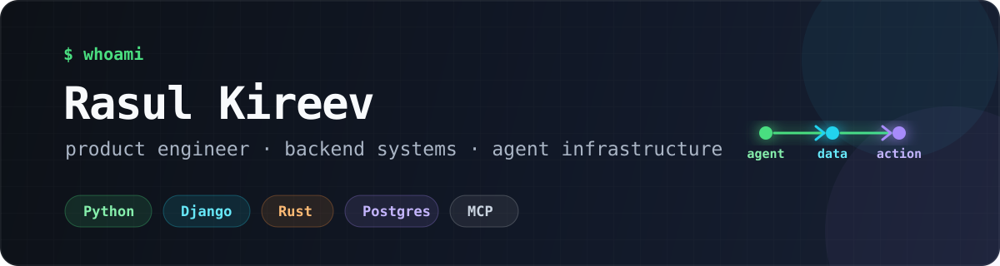

  

## I turn messy workflows into dependable products.

I'm a Senior Growth Engineer at [Readwise](https://readwise.io/) and an independent product builder at [LVTD](https://github.com/LVTD-LLC). I work mostly with Python, Django, PostgreSQL, Rust, and Go—usually where agents, data, and production systems meet.

The short version: I like finding consequential problems, shipping the whole solution, and staying around for the retries, migrations, observability, and awkward edge cases.

### What I'm building

| Project | What it does | Under the hood |
| --- | --- | --- |
| [Rowset](https://github.com/LVTD-LLC/rowset) | Gives AI agents a structured dataset backend with stable, inspectable interfaces | Python, Django, FastMCP, Go, Postgres |
| [PGSandbox](https://github.com/LVTD-LLC/pgsandbox) | Lets coding agents test SQL and migrations in disposable, isolated Postgres databases | Rust, MCP, Tokio, Postgres |
| [ReviewGate](https://github.com/LVTD-LLC/reviewgate) | Adds open-source review gates for agent-written pull requests | Rust, GitHub Actions, OpenRouter |
| [Tech Job Alerts](https://github.com/LVTD-LLC/tjalerts) | Turns scattered developer job posts into structured search and personalized alerts | Django, pgvector, background jobs, PostHog |
| [Built with Django](https://github.com/LVTD-LLC/builtwithdjango) | Showcases products built by the Django community | Django, Postgres, community submissions |
| [Django SaaS Starter](https://github.com/LVTD-LLC/django-saas-starter) | A production-ready starting point for modern Django SaaS products | Django, HTMX, Alpine.js, Docker |

### How I work

- **Product first.** I care about the user and the outcome, not just the implementation.
- **Own the unglamorous parts.** Data integrity, queues, retries, monitoring, migrations, and documentation are part of the product.
- **Build for humans and agents.** Good tools expose explicit contracts, bounded actions, and useful evidence.
- **Write things down.** Clear issues, pull requests, runbooks, and technical notes make remote teams faster.

### Current interests

`agent-native software` · `developer tools` · `data systems` · `Django` · `Rust` · `MCP` · `self-hosting`

### Elsewhere

[Website](https://rasulkireev.com) · [Writing](https://rasulkireev.com/articles/) · [X](https://x.com/rasulkireev) · [LinkedIn](https://www.linkedin.com/in/rasul-kireev/) · [Email](mailto:me@rasulkireev.com)

If you're exploring the repositories, start with Rowset, PGSandbox, and ReviewGate. They best represent what I'm working on now.
